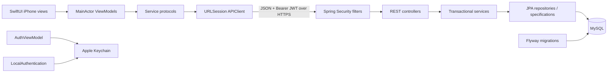

# Architecture

## Separation

Frontend and Backend are independently runnable projects. Swift has no database credentials or direct database access. All persistent student/attendance/note operations pass through the backend. Java contains no biometric logic.

## MVVM

Views render published state and invoke ViewModel actions. ViewModels own asynchronous loading, validation, pagination and error/success state. Services implement protocol-based operations and encode request DTOs. APIClient builds URL requests, adds the session token, validates HTTP codes and decodes the standard envelope. Authentication and routing use EnvironmentObject; view-owned models use StateObject, injected models use ObservedObject.

The root route is login, biometric lock, or the four-tab main view. NavigationStack handles student details, attendance history and notes. Swift Charts renders server-calculated dashboard counts. Semantic system colors adapt to dark mode, with SF Symbols and text alongside attendance colors. Controls use Dynamic Type styles and accessibility labels.

## Backend boundaries

Security validates the JWT signature, issuer and expiration and loads the teacher principal. Controllers use Jakarta validation. Services resolve that principal's database identity and scope every record lookup; foreign record IDs return 404. Entity-to-DTO mappers prevent password/relationship serialization. Constructors provide dependencies. Flyway owns schema evolution; Hibernate only validates it.

Bulk attendance has one transaction. A later invalid/foreign student causes all earlier writes in that batch to roll back. Unique teacher/roll and student/date constraints protect concurrent writes. Attendance POST is an upsert, so repeated saves do not create additional days. Student DELETE archives the row and preserves children.

## Scope and operations

JWTs have no refresh or revocation table. Local logout removes Keychain state; an already copied token remains valid until expiration. The IP authentication limiter is per process. Use a shared gateway limit for a multi-instance deployment. Dashboard aggregation and per-student status mapping favor clarity for a classroom-scale project; very large deployments should move count operations to aggregate queries and batch status fetches. Backend timestamps are UTC. Request dates are explicit calendar dates; omitted backend dates use UTC.
