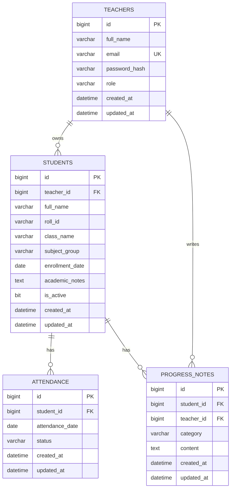

# MySQL schema

Database: `classtrack_db`. Migrations are in [db/migration](../Backend/src/main/resources/db/migration). Tables use InnoDB with UTF-8 database collation. Identifiers are BIGINT/Java Long/Swift Int64. Timestamps use UTC DATETIME(6); enrollment and attendance use DATE.



- Unique `teachers.email`; emails are stripped and normalized to lowercase before storage.
- Unique `(students.teacher_id, students.roll_id)`, including archived students. Different teachers can reuse the same roll ID.
- Unique `(attendance.student_id, attendance.attendance_date)`. Status CHECK permits PRESENT, ABSENT, LATE. Unmarked means no row exists.
- Foreign keys preserve referential integrity. No cascading physical student delete is exposed.
- Indexes support active rosters, attendance dates and recent notes.
- Attendance and notes remain readable by their owner after a student is archived. Inactive students are excluded from dashboard totals and recent lists.
- Attendance before enrollment is rejected with 422. Repeated attendance POST updates the existing record. Bulk inputs with repeated student/date keys are rejected before writes.

Setup:

```sql
CREATE DATABASE IF NOT EXISTS classtrack_db CHARACTER SET utf8mb4 COLLATE utf8mb4_0900_ai_ci;
```

Flyway runs V1–V4 at startup. Do not edit applied migrations; add a new version for later schema changes. `ddl-auto=validate` prevents Hibernate from silently changing the schema.
